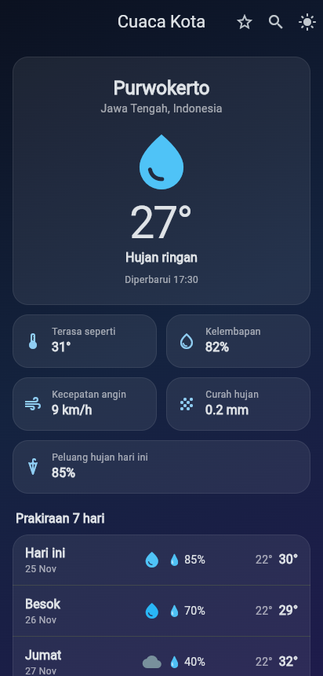
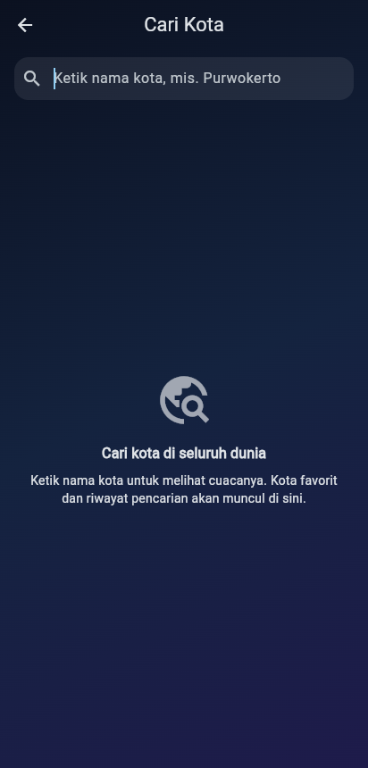
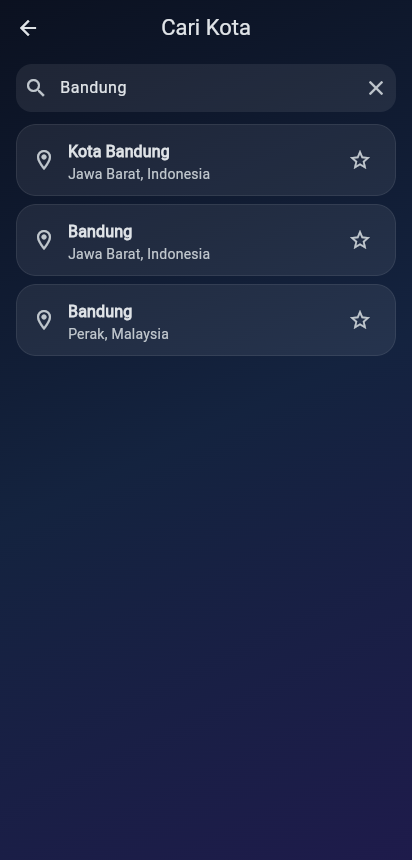

# Cuaca Kota — Responsi Pemrograman Mobile (Flutter)

Aplikasi cuaca sederhana berbasis **Flutter** yang mengambil data langsung dari **Open-Meteo REST API**.

| | |
|---|---|
| Nama | Ahmad Fikri Zakaria |
| NIM | H1D024062 |
| Mata kuliah | Pemrograman Mobile B (Informatika, Universitas Jenderal Soedirman) |
| Shift | Awal B, Akhir C |

## Fitur

- Cari kota di seluruh dunia berdasarkan nama (Geocoding API), pencarian memakai debounce 500 ms.
- Halaman cuaca: nama kota, kondisi saat ini, suhu, terasa seperti, kelembapan, kecepatan angin, curah hujan, peluang hujan hari ini, dan prakiraan 7 hari (suhu min/maks + peluang hujan).
- **Local storage** (`shared_preferences`): kota favorit, riwayat pencarian (maks. 8), kota terakhir dilihat, dan pilihan tema. Semuanya tampil kembali saat aplikasi dibuka ulang.
- Penanganan state **loading / kosong / error** (ada tombol *Coba Lagi*), pull-to-refresh.
- Tema gelap/terang (Material 3), latar gradasi lembut, tampilan responsif.

## Screenshot

| Home / Cuaca | Search kosong (favorit + riwayat) |
|---|---|
|  |  |

| Search: hasil pencarian | Search: kota favorit ditandai bintang |
|---|---|
|  |  |

## Struktur Aplikasi

Arsitektur **MVVM** dengan **Provider** (`ChangeNotifier`) sebagai state management.

```
lib/
├── main.dart                     # titik masuk: inisialisasi storage + runApp
├── app.dart                      # MultiProvider + MaterialApp (tema terang/gelap)
├── core/
│   ├── app_theme.dart            # Theme Material 3 + warna gradasi latar
│   └── weather_codes.dart        # kode cuaca WMO -> teks Indonesia, ikon, warna
├── models/                       # MODEL
│   ├── location.dart             # Location (hasil geocoding, bisa disimpan sebagai JSON)
│   └── weather.dart              # CurrentWeather, DailyForecast, WeatherData (JSON -> Dart)
├── services/
│   ├── open_meteo_service.dart   # request HTTP GET ke Open-Meteo + ApiException
│   └── local_storage.dart        # pembungkus shared_preferences
├── repositories/
│   └── weather_repository.dart   # penghubung ViewModel <-> service
├── viewmodels/                   # VIEWMODEL
│   ├── load_status.dart          # enum idle/loading/success/empty/error
│   ├── weather_view_model.dart   # kota terpilih, data cuaca, status
│   ├── search_view_model.dart    # query, hasil, riwayat, debounce
│   ├── favorites_view_model.dart # daftar favorit (tersimpan)
│   └── theme_view_model.dart     # mode gelap/terang (tersimpan)
└── views/                        # VIEW
    ├── weather_screen.dart       # Layar 1: Home / Cuaca
    ├── search_screen.dart        # Layar 2: Search / Lokasi
    └── widgets/                  # komponen yang dipakai ulang
```

Alur data: **View → ViewModel → Repository → Service → Open-Meteo API**. View hanya membaca state dari ViewModel (`context.watch` / `Consumer`) dan memanggil fungsi ViewModel; tidak ada pemanggilan API di dalam View.

## Implementasi API (Open-Meteo)

Kedua endpoint dipanggil dengan HTTP **GET** memakai paket `http`, respons JSON diubah menjadi model Dart.

1. **Geocoding** (cari kota)
   `https://geocoding-api.open-meteo.com/v1/search?name=<kota>&count=10&language=id&format=json`
   Jika kota tidak ditemukan, API tidak mengirim key `results`, sehingga hasilnya dianggap daftar kosong (state *empty*).
2. **Forecast** (cuaca)
   `https://api.open-meteo.com/v1/forecast?latitude=..&longitude=..&current=temperature_2m,relative_humidity_2m,apparent_temperature,precipitation,weather_code,wind_speed_10m&daily=temperature_2m_max,temperature_2m_min,precipitation_probability_max&timezone=auto&forecast_days=7`

Penanganan error: timeout 15 detik, status bukan 200, JSON tidak valid, dan tidak ada internet semuanya diubah menjadi `ApiException` dengan pesan ramah yang ditampilkan di layar. Request memakai `requestId` agar respons lama tidak menimpa respons yang lebih baru.

## Penerapan MVVM

- **Model** (`models/`): `Location`, `CurrentWeather`, `DailyForecast`, `WeatherData`; berisi `fromJson` / `toJson`.
- **ViewModel** (`viewmodels/`): menyimpan state dan logika; memanggil `notifyListeners()` setiap state berubah.
- **View** (`views/`): `StatelessWidget` / `StatefulWidget` yang hanya menampilkan state dan meneruskan aksi pengguna.

## Cara Menjalankan

```bash
flutter pub get
flutter run            # pilih emulator/HP Android, atau: flutter run -d chrome
flutter test           # 22 unit/widget test (API dimock, tidak butuh internet)
```

Butuh koneksi internet saat aplikasi dijalankan. Izin `INTERNET` sudah ditambahkan di `AndroidManifest.xml`.

## Dependensi

`provider`, `http`, `shared_preferences`, `intl`.

Sumber data cuaca: [Open-Meteo.com](https://open-meteo.com/) (CC BY 4.0).
